## Challenge

>Another one got caught today, it's all over the papers.
>
>Try to figure out what made this one tick...


## Recon

Like every other OSINT challenge, when we are given an image, we first look through the metadata using tools like `exiftool`. Unfortunately, this images metadata was filled with random AI stuff, so I couldn't find anything useful there. After that I decided to carefully analyze the text in the image, and oh magic, I noticed in the text that the arrested person was **Karl Heisenburger** and he was apparently active user in **BlueSky**. 

## BlueSky

In BlueSky I searched for the user Heisenburger and there we go, the first account is the one we are looking for. From the profile posts, we found this interesting post.

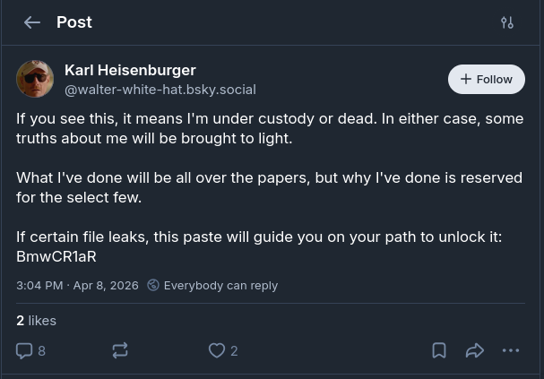

Already we can see in the post an interesting information: `BmwCR1aR`. Now because I have seen such strings before, my immediate thought was that this string must be part of some online hosted files url. So after searching in several popular file hosting sites, I ended up finding this `https://pastebin.com/BmwCR1aR`. In the pastebin we can see a link to a google drive file.

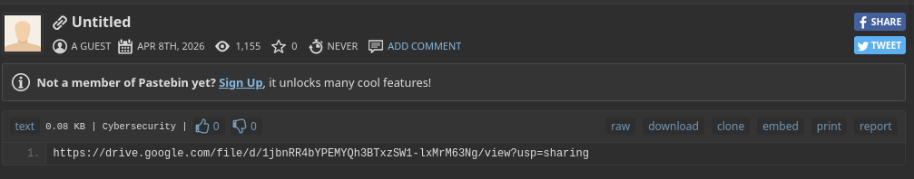

## Secret-Key

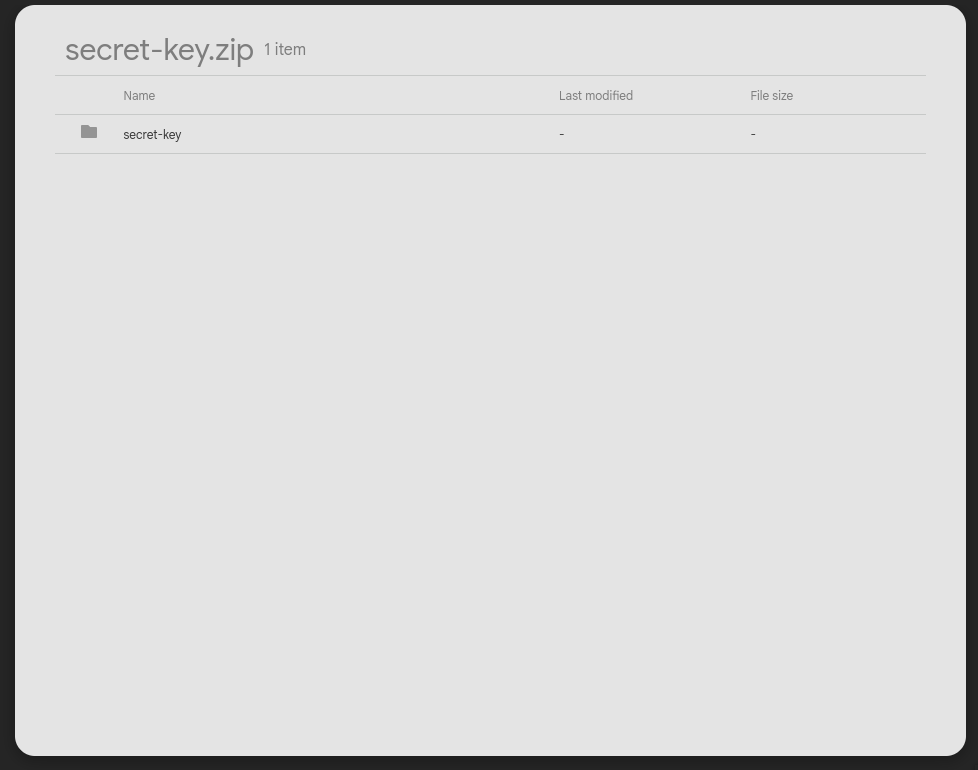

When we open the google drive link, we can see a directory named `secret-key`, but oh boy I wish it was that easy. When downloading the directory, we can see the following directory structure:

```
secret-key
├── .git
│   ├── ...
│   └── ...
└── README.md
```

Now the `README.md` file contains a lot of text (788 words).

After reading first few paragraphs, we can get everything we need to know.

```
I considered simply spilling it out, but it doesn't feel right. I don't wish to
reveal that answer to everyone, just to a specific type of individual, someone
special, someone like me...
```

It is clear that we are not getting the secret key from the `README.md` that easily. Now it is perfect time to check the `.git`. 

## Git

After using `git log` I saw lots of commits, out of curiosity I checked the number of commits and it was **480** commits. Now I want to say that I was smart enough not to check every single commit by hand, but I wasn't, and after checking all of them I didn't find anything useful, so I decided to check bluesky account again and found a post that might help us.

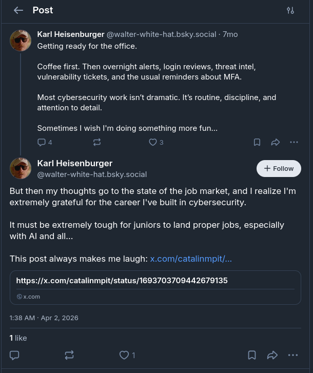

If we go through link we will see this post on X. 

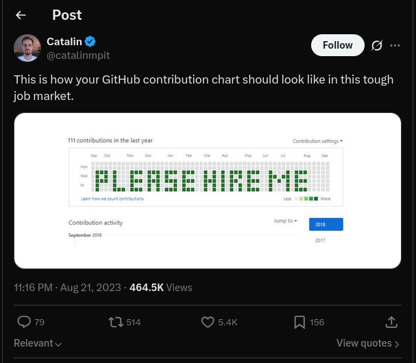

This gives us an idea that the commit messages might reveal a hidden information, if we view them in github activities. 

What is the best way to do that?
Personally I am not aware of any fancy tools that might help us for this case, so I just decided to push it to github and see it myself. However, of course we are not able to do it that easily without first changing the commits so that we are the authors, otherwise the activity will not display in our github page. To change commit authors to ourselves we need to execute the following commands that I found after 10 minutes googling.

```sh
$ git config user.name <github username>
$ git config user.email <github email>
$ git rebase -r --root --exec "git commit --amend --no-edit --reset-author"
```

After that we need to create new repository in github and push it using these commands

```sh
$ git remote add origin <repo link>
$ git push -u origin main
```

Now if you go to your repo you can find something like this. In your contribution activity:

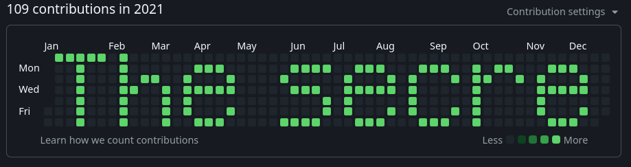
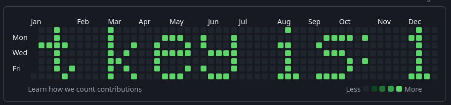
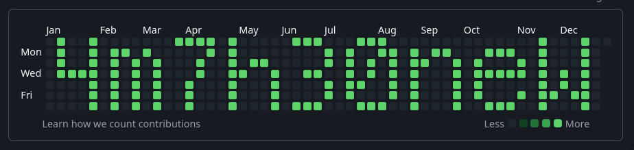
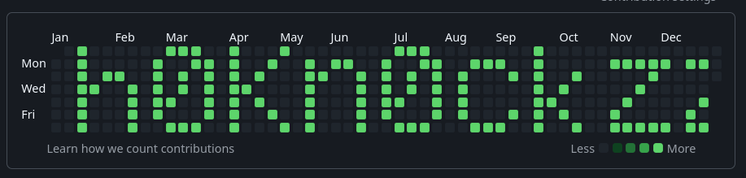
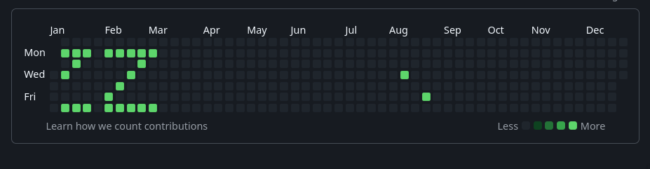

The secret key is: `14m7h30neWh0Kn0ckzzz`

We got the secret key, however we don't know what should we do with that key.

From `.git` files we get the github username `w4l73r-8l4ck-H4t` which we can use to find the original github user and his repo.

After not so thorough searches we find this github user 
https://github.com/w4l73r-8l4ck-H4t

We can see that he has only one repo https://github.com/w4l73r-8l4ck-H4t/image-encryptor. Which means we need to find some sort of encrypted file to decrypt it with the key we found.

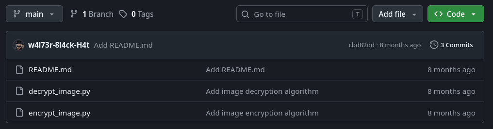

## Back in Time

We still do not have the file that we need to decrypt. So we go back to analyze BlueSky social. Current posts did not help us any way, so we decided to look on `wayback machine` for any possibility to reading posts that were deleted.


There it is. The single snapshot back in April 1st. And sure enough there is the post we were looking for.

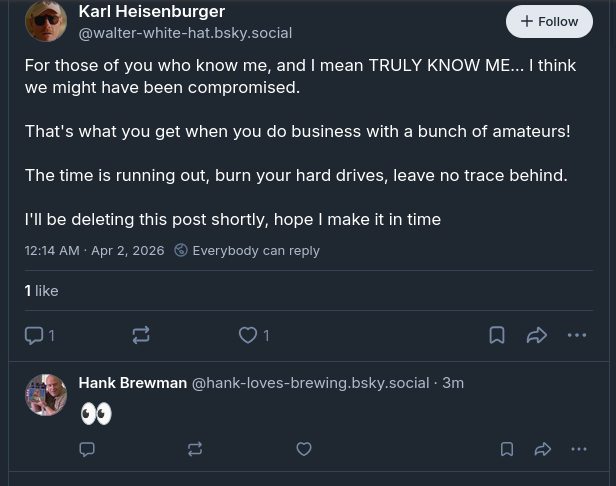

We can see that `Karl Heisenburger` is talking about being compromised, and the only comment to that post is from `Hank Bewman`. So lets check him out.

Hank has several posts in his profile, but the one that might interest us is this one posted on April 2nd right the day after Heisenburger said that he was compromised.

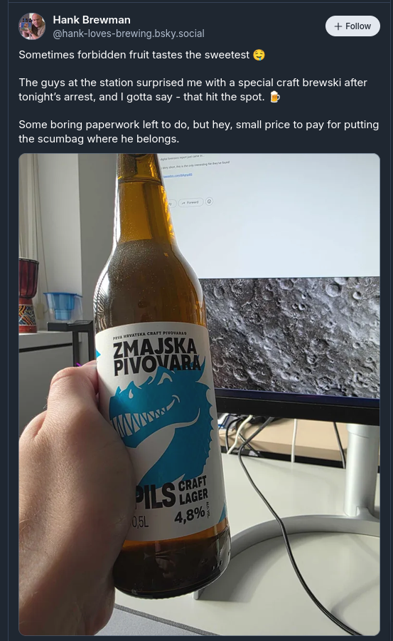

If we zoom in the picture a little bit we can see this on his computer screen that can help us.

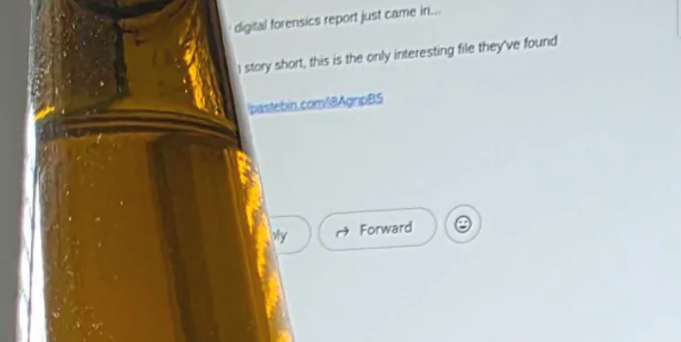

We can barely see pastebin link that might direct us to file that we can download and decrypt. `https://pastebin.com/i8AgnpB5`. After opening pastebin there is a google drive link that leads to the document `why_i_did_what_i_did.png.enc`.

## Final Stage

Using the github script we found, the secret key `14m7h30neWh0Kn0ckzzz` and the document `why_i_did_what_i_did.png.enc` we run the following command:

```sh
$ python3 decrypt_image.py why_i_did_what_i_did.png.enc 14m7h30neWh0Kn0ckzzz
```

We then receive the decrypted PNG file with the flag in it.


## Flag

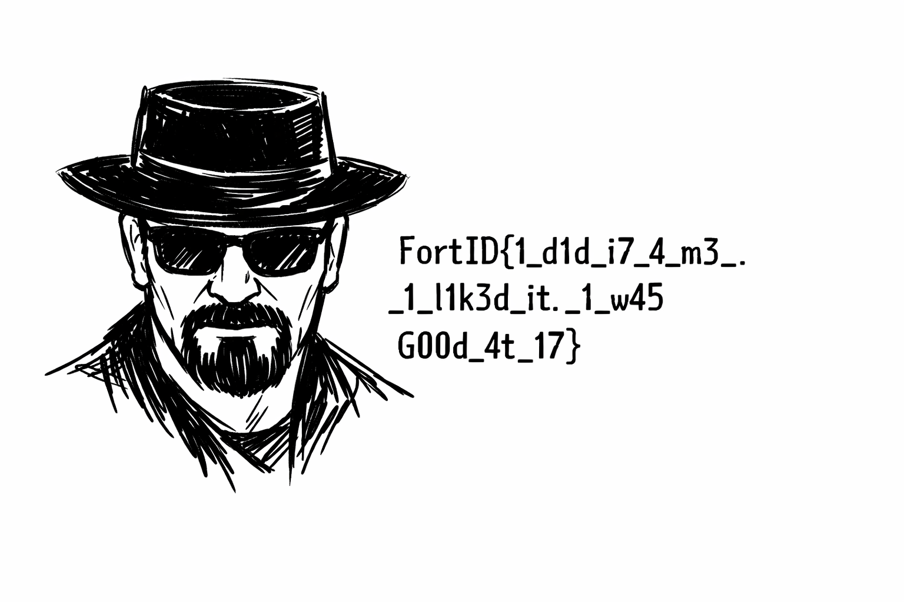