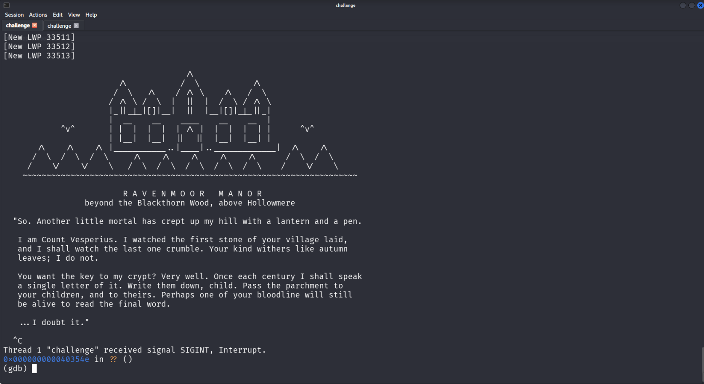
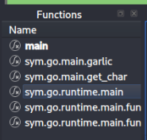
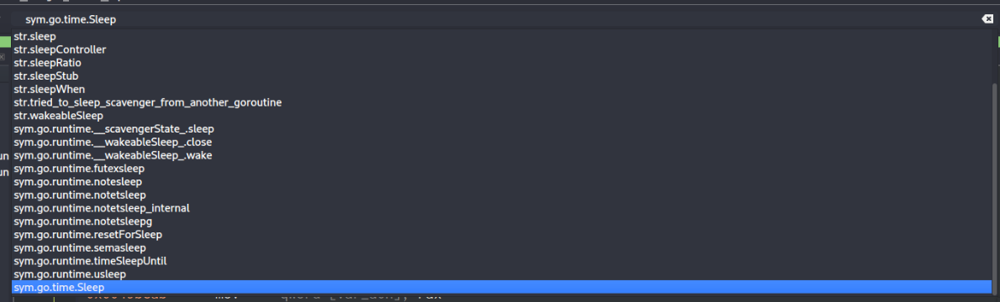
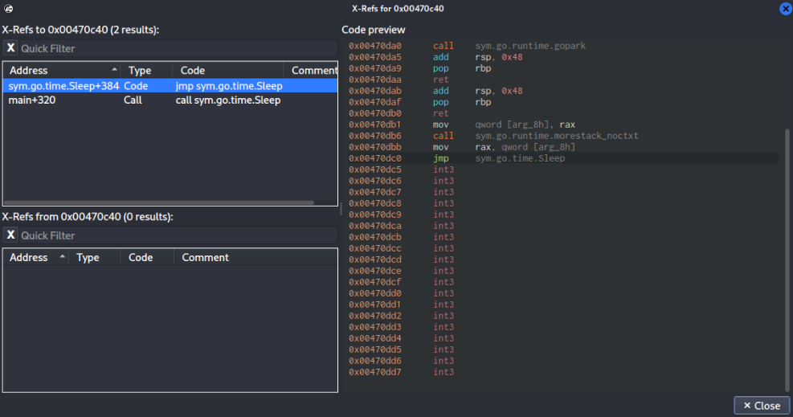
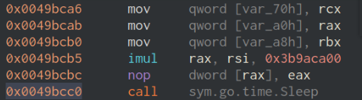
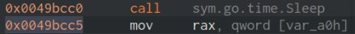
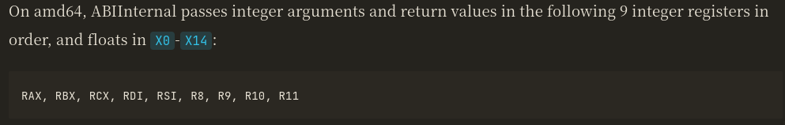
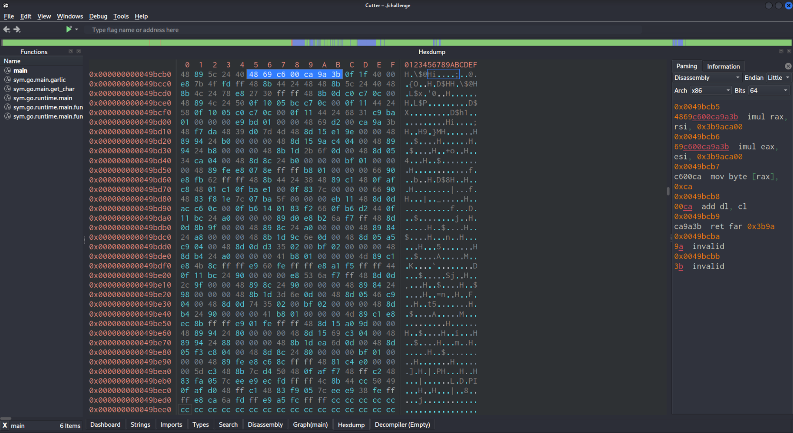
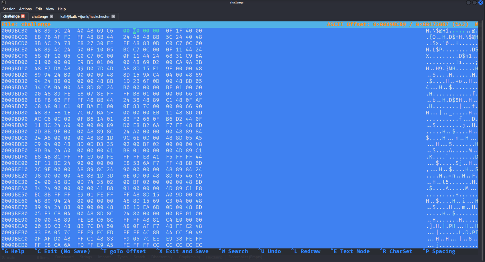

## Challenge

> Beyond the Blackthorn Wood, past where the lanterns of Hollowmere stop, Ravenmoor Manor still stands. Its master, Count Vesperius, has not aged a day since the village was founded.
>
> This Hallow's Eve a letter turned up nailed to the church door:
>
> "Your kind withers like autumn leaves. Once each century I shall speak one letter of the key to my crypt. Record my messages, if thy bloodline endures that long."
> 
> The village elders are getting on a bit. Find a way to hear him out.
> 
> Keep a copy of the binary. The Count is easily offended.

Given: `challenge` file

## Recon

From the challenge description it is easy to understand what our goal should be with the binary `"Your kind withers like autumn leaves. Once each century I shall speak one letter of the key to my crypt. Record my messages, if thy bloodline endures that long."` This means once a century a letter from the flag will be printed on our screen. Since we cannot wait that long we are left with an option to trick the program to print our flag faster.


Lets run our program with `gdb`

```sh
$ gdb ./challenge
```

Now if we type `run` and run it we can see the program gets stuck, presumably it waits for centuries to print character.



Now lets take a look at the assembly of the program. I will be using `cutter` for this challenge because it provides a fairly good interface for viewing binaries in assembly. We just need to run `cutter ./challenge`. Already we can see many unrecognized function. If we search for the `main` function and we see the following functions filtered out.



As we can see it is a `go` binary, and the main function here should be `sym.go.runtime.main`. Lets move there and search for sleep function. By googling I found out that sleep function in go looks like this `time.Sleep(d Duration)`. From searching in `cutter` I found the following:



Lets jump to that part of the code and see where it is being called. If we right-click on `sym.go.time.Sleep` and press `Show X-Refs` we see there is only one place where we should look.




`0x0049bcc0`

Now with all the necessary information lets move to exploitation.


## Exploit 1 - Not So Easy Way


One way to solve this challenge is to tell `gdb` to skip the function call. Ata low level we know that *instruction pointer* register `rip` is responsible for storing addresses in memory which points to machine code instruction that is being executed. So hypothetically if we are able to change the instruction pointer as soon as it reaches to `time.Sleep` to the next instruction address we will be able to skip it. Now lets do that.



We can see that next instruction to our call function is located at `0x0049bcc5`. Now we are ready to move to `gdb`.

```sh
(gdb) break *0x0049bcc0           // setting the breakpoint
Breakpoint 1 at 0x49bcc0
(gdb) commands 1                  // commands to run during 1st breakpoint
Type commands for breakpoint(s) 1, one per line.
End with a line saying just "end".
>silent                           //  command to see the output cleaner
>set $rip=0x0049bcc5              //  changing $rip to next address
>continue                         //  continue without stopping on breakpoint
>end                              //  exit command mode
(gdb) run
```

And we can see the flag in the output.


## Exploit 2 - The Hard Way


Now another way to solve this challenge, is to change value of the first parameter that is being passed to function to be equal 0. Using https://golang.design/under-the-hood/en/part1overview/ch02asm/callconv/, we see that integer parameters of a function are stored in the following registers, in the following order:



So to modify sleep time we can change `%rax` to 0 using `gdb`. For that we run the following commands

```sh
(gdb) break *0x0049bcc0           // setting the breakpoint
Breakpoint 1 at 0x49bcc0
(gdb) commands 1                  // commands to run during 1st breakpoint
Type commands for breakpoint(s) 1, one per line.
End with a line saying just "end".
>silent                           //  command to see the output cleaner
>set $rax=1                       //  setting $rax = 0
>continue                         //  continue without stopping on breakpoint
>end                              //  exit command mode
(gdb) run
```

And we see the flag in the output.


## Exploit 3 - Intended Way


Now we can see that there is some sort of multiplication is going on before the function call

```asm
imul rax, rsi, 0x3b9aca00 
```

What this instruction does, it multiplies `rsi` with `0x3b9aca00` and stores the result in `rax`. So, if we are able to change the number to be 0, it will mean that `rax` is now `0`, so our sleep will work for 0 seconds.

```asm
imul destination, source1, source2
```

Lets look at its hexdump. If we select that part, and right click `show in > hexdump` we can see it in hexdump. Because this binary was compiled for a little-endian processor, the least significant byte comes first. So, in the hexdump, the order of bytes in the number is reversed. We can see that this line corresponds to our instruction. 



Now lets open challenge file with `hexeditor` and find our bytes `69 c6 00 ca 9a 3b` with built in search (ctrl + w), and change the number part to be 0. So we need to turn `00 ca 9a rb` into `00 00 00 00`. Our final hex code should be the following:



Now we save and exit (ctrl + x). And if we run we can see whole output with flag there.


## Exploit 4 - Impossible

Wait for centuries :)


## Flag

`HxM{REDACTED}`
